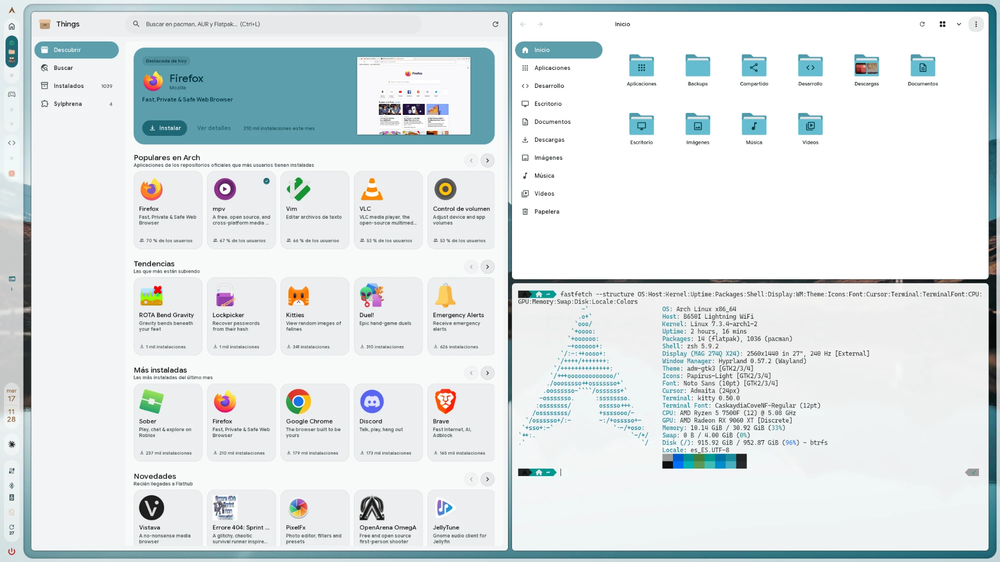
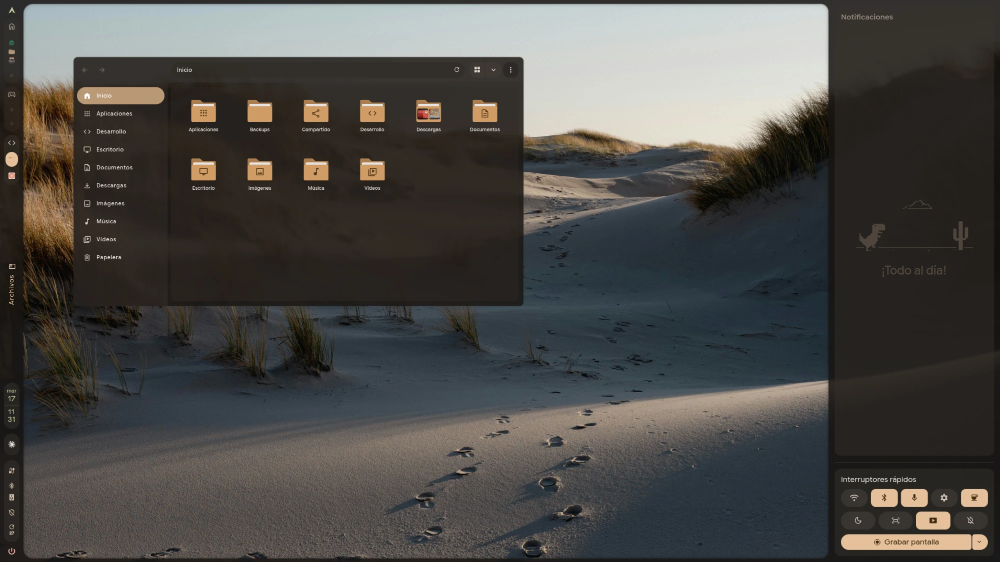
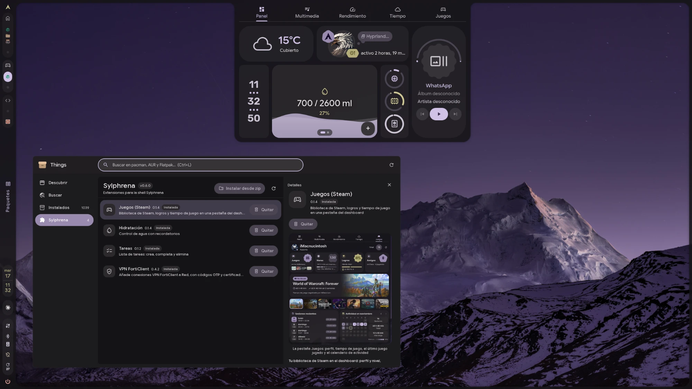

# Manuel López

**Software Architect**

## ✦ Sylenara

  
  

Every colour comes from the wallpaper: the shell, its apps, GTK/Qt apps and the terminal change together.

**Sylenara** (*si-le-NA-ra*) is a complete Material You desktop for Arch Linux + Hyprland: shell, settings, login screen,
installer, extensions and its own apps, all sharing one visual language and one theme.

| Project | What it is |
| --- | --- |
| **[sylenara-shell](https://github.com/iMacnucintosh/sylenara-shell)** | The shell: activities, panels, settings and login screen (Quickshell · QML · C++) |
| **[things](https://github.com/iMacnucintosh/things)** | Package manager: pacman, AUR and Flatpak in a single list (Qt 6 · C++20) |
| **[seeker](https://github.com/iMacnucintosh/seeker)** | File manager (Qt 6 · QML) |
| **[veo](https://github.com/iMacnucintosh/veo)** | Minimal video player (libmpv · Qt Quick) |
| **[sylenara-cli](https://github.com/iMacnucintosh/sylenara-cli)** | `syl`, the control CLI (Python) |
| **[sylenara-hub](https://github.com/iMacnucintosh/sylenara-hub)** | Extensions and widgets |
| **[sylenara-packages](https://github.com/iMacnucintosh/sylenara-packages)** | Signed pacman repository, built by CI |

## Other projects

- **[synapsex](https://github.com/iMacnucintosh/synapsex)**: Razer Synapse for Linux (Rust)
- **[Steamfresh](https://github.com/iMacnucintosh/Steamfresh)**: your Steam library on the web and Android (Flutter · Cloudflare Workers) · [demo](https://imacnucintosh.github.io/Steamfresh/)
- **[steam-better-achievements](https://github.com/iMacnucintosh/steam-better-achievements)**: a nicer Steam achievements view (Millennium plugin)
- **[TheRules](https://github.com/iMacnucintosh/TheRules)**: a party board game (Flutter web) · [demo](https://imacnucintosh.github.io/TheRules/)
- **[Booktion](https://github.com/iMacnucintosh/Booktion)**: personal library backed by Notion (Flutter)

## Stack

  
  
  
  
  
  
  
  
  
  
  
  
  
  
  
  
  
  

